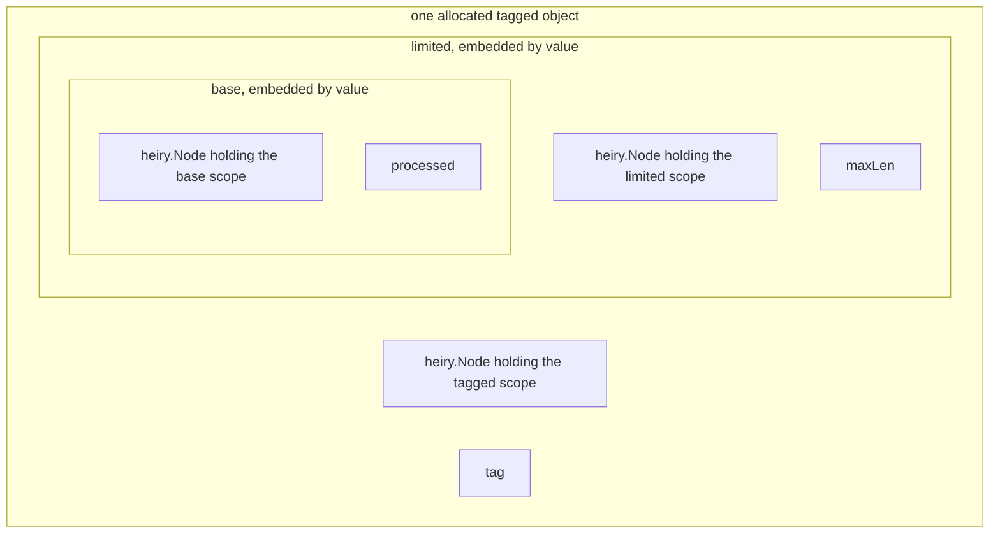
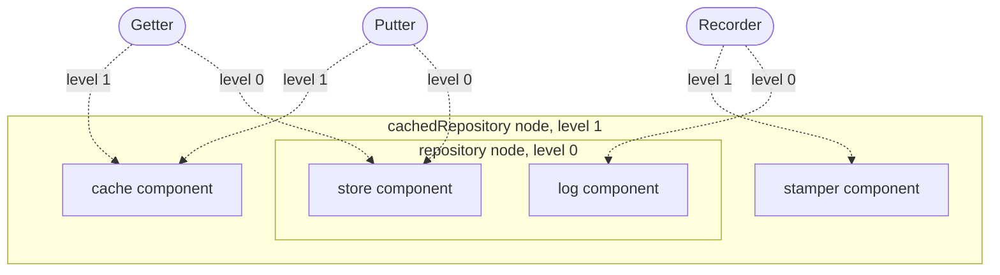
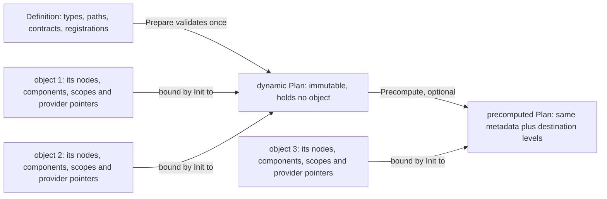
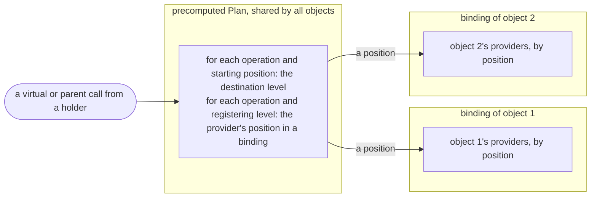
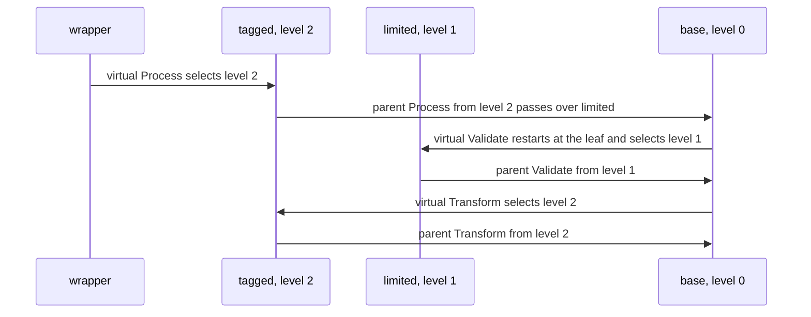

# User guide

This guide explains how to use heiry. It describes the implemented package; the [specification](../specification.md) remains the authority on required behavior, and the [examples](../../examples/README.md) are runnable programs for everything shown here.

heiry is released as `v0.x`: until `v1.0.0`, the API may still change between versions. The [changelog](../../CHANGELOG.md) lists each release. It needs the Go version declared in `go.mod`.

## What heiry does

Go embedding reuses fields and methods, but a method of an embedded type cannot reach an override declared by the type that embeds it. heiry adds that missing piece for single inheritance:

- A **virtual call** selects the most-derived implementation of an operation in the complete object.
- A **parent call** selects the closest implementation below the level that is executing.
- Ancestors are embedded **by value**, so one allocated object holds all the state.
- Calls stay ordinary typed Go method calls on an interface. There is no reflective invocation and no `unsafe`.

Consider heiry when a hierarchy has several levels or several implementation providers per level, and you want explicit registration, validation of the whole hierarchy, and checked binding of every object. For a small hierarchy in one package, plain embedding or a hand-written self interface is usually simpler and faster; see [alternatives](alternatives.md).

## Running the examples

```sh
go run ./examples/basic
go run ./examples/components
go run ./examples/lifecycle
go run ./examples/comparison
go run ./examples/generated
```

The [examples index](../../examples/README.md) says what each one shows.

## Concepts

| Term | Meaning |
| --- | --- |
| Operation | One method, identified by a single-method interface such as `interface{ Validate(msg string) error }`. Use one interface type per operation everywhere; a second type with the same shape is a different key. |
| Contract | An ordinary interface listing operations. Each level has a **public** contract (offered to consumers) and a **private** one (for the hierarchy's own levels). |
| Level | One struct type in the inheritance chain. The last level is the **leaf**: the type you allocate. |
| Provider | The receiver that implements an operation at a level: the level's node itself, or a **component** stored inside it. |
| `heiry.Node` | A small holder that every node and every component embeds directly. After initialization it carries that receiver's **scope**, and bodies dispatch through it: `receiver.Node.Virtual[T]()` and `receiver.Node.Parent[T]()`. |
| Scope | A fixed position: which object, and which level. `receiver.Node.Scope()` returns it for code that needs the position without the receiver. |
| Definition | The receiver-free description of a hierarchy. |
| Plan | The validated, immutable result of preparing a Definition. It is shared by all objects. |

## Structure of an object

Each level embeds its parent as an anonymous **value** field and embeds its own `heiry.Node`:

```go
type base struct {
	heiry.Node
	processed int
}

type limited struct {
	base
	heiry.Node
	maxLen int
}

type tagged struct {
	limited
	heiry.Node
	tag string
}
```

One `tagged` value physically contains its `limited` and `base` parts. Nothing is allocated separately and no state is copied.



Boxes show physical containment. Each level has its own `heiry.Node`, so a body always dispatches from its own level through `receiver.Node`.

Rules for the chain:

- Levels are distinct named struct types.
- Each child holds its parent as exactly one direct, anonymous, value field. Pointer embedding is rejected.
- Every level node directly embeds a value `heiry.Node`. A `Node` promoted from an ancestor does not count.

## Declaring a hierarchy

A declaration lists the levels from root to leaf. It involves no object:

```go
var hierarchy = heiry.Define[tagged]().
	Level[base, Public, Private]("").
	BindNode[Processor]((*base)(nil)).
	BindNode[Describer]((*base)(nil)).
	BindNode[Validator]((*base)(nil)).
	BindNode[Transformer]((*base)(nil)).
	Extend[limited]().
	BindNode[Validator]((*limited)(nil)).
	Extend[tagged]().
	BindNode[Processor]((*tagged)(nil)).
	BindNode[Describer]((*tagged)(nil)).
	BindNode[Transformer]((*tagged)(nil))
```

- `Define[Leaf]()` starts a Definition. The last level's node type must be `Leaf`.
- `Level[Node, Public, Private](parentField)` declares the root, with `""` as its parent field.
- `Extend[Node]()` adds the next level with the same contracts as the level before it.
- `ExtendWith[Node, Public, Private]()` adds the next level with new contracts.
- `BindNode[Operation](witness)` registers that this level's own node implements one operation. The witness is a typed nil pointer; only its type is kept.

The chain can continue from any level handle, and the last handle can validate, prepare and initialize. `End()` returns the Definition when you need that type. The same calls can also be written as separate statements on saved level handles: a registration always goes to the handle's own level, and a new level is always added at the end.

### Naming the parent field explicitly

`Extend` and `ExtendWith` find the parent themselves: it is the one directly embedded value field whose type is the previous level's node type. If there is no such field, or more than one, validation reports `InvalidHierarchy`. More than one is possible only when the same type is embedded twice under different alias names. In that case, declare the level with `Level` and name the field:

```go
Level[limited, Public, Private]("base")
```

The name is the field's declared name: the parent's type name, or the alias name when the parent is embedded through a type alias. `Level` with a name is always available, also when inference would work.

`Extend` and `ExtendWith` need a level before them. Called first on a Definition, they add nothing and record an `InvalidDeclaration` error that the Definition then reports.

Registration is always explicit. A level that lists nothing for an operation inherits it. heiry never infers an override from a type's method set.

### Contracts

- The root must supply both contracts. Use `interface{}` for an empty one.
- Each child's public contract must contain its parent's public contract, and likewise for the private one. A child may add operations by declaring its level with `ExtendWith` or `Level`.
- An operation cannot appear in both contracts, and operation names must be exported.
- Every operation in the leaf's contracts must be registered at some level. Intermediate levels may leave operations unimplemented.
- A level can register only operations that its own contracts declare, and each operation at most once per level.

### Typed and grouped registration

There are two ways to register, each with a form for the node and a form for a component:

| | The level's own node | A component, by field path |
| --- | --- | --- |
| One operation, checked by the compiler | `BindNode[Operation](witness)` | `Bind[Operation](witness, path)` |
| Several operations, checked at validation | `BindNodeGroup(witness, operations...)` | `BindGroup(witness, path, operations...)` |

With the individual forms the compiler checks that the witness type implements `Operation`.

The grouped forms register several operations for one provider in a single call:

```go
BindGroup((*store)(nil), "store", heiry.Of[Getter](), heiry.Of[Putter]())
```

Here the compiler checks only that the witness is a pointer. Whether the provider implements each listed operation is checked when the Definition is validated. Calls made through either form are equally typed: `receiver.Node.Virtual[Getter]()` returns a `Getter`.

`BindNode(w)` and `BindNodeGroup(w, ...)` are exactly `Bind(w, ".")` and `BindGroup(w, ".", ...)`; the path `"."` means the node itself.

## Components

A level's operations can be supplied by struct values stored inside its node instead of, or in addition to, the node itself. Each such component embeds its own `heiry.Node`:

```go
type repository struct {
	heiry.Node
	store store
	log   auditLog
}
```

The registration path names the field that holds the component, relative to the level's node:

```go
Level[repository, Public, Private]("").
	BindGroup((*store)(nil), "store", heiry.Of[Getter](), heiry.Of[Putter]()).
	Bind[Recorder]((*auditLog)(nil), "log")
```



Boxes show physical containment. Dotted arrows show provider ownership: which provider is registered for an operation at which level. Components do not add levels: `cache` and `stamper` share level 1.

Rules for components:

- A path is a sequence of direct field names separated by dots, such as `"store"` or `"outer.inner"`. An anonymous field uses its declared field name: its type name, or the alias name when it is embedded through a type alias. Selectors that rely on promotion are not paths.
- Fields may be exported or unexported, named or anonymous, but every step must be a struct **value**. Pointers, interfaces, slices and maps are not followed.
- A component must be stored in its own level's node, outside the embedded parent.
- Two fields of the same type are two different components; the path identifies them.
- A component shares its level's contracts and position. A parent call from a component starts below that level and never selects a sibling component.

## Lifecycle

Three steps are kept separate.

| Step | Call | Happens |
| --- | --- | --- |
| Declaration | `Define`, `Level`, `Extend`, `ExtendWith`, and the `Bind` forms | Records types, paths, contracts and registrations |
| Preparation | `Prepare` or `MustPrepare` | Validates the whole Definition once and returns an immutable Plan |
| Initialization | `Init` or `MustInit` | Checks one allocated object and installs its scopes |



Arrows from objects point to the Plan they use. No arrow leaves a Plan toward an object: preparation constructs no application object, and a Plan never stores a receiver, a scope or any other part of one. Each object keeps its own provider pointers and scopes.

### Validation and preparation

- `Validate()` checks the current Definition and returns every problem it can establish, without freezing anything.
- `Prepare()` validates and returns the Plan. Calling it again returns the same Plan without repeating the work.
- Preparation freezes the Definition. A later declaration call changes nothing and records an `InvalidDeclaration` error that the Definition then reports from `Validate`, `Prepare` and `Init`. A Plan obtained earlier keeps working.
- A failed preparation publishes no Plan and leaves the Definition editable; the next call validates it again. Errors recorded by a malformed declaration call stay with that Definition.

### Eager and lazy preparation

Both schedules use the same declaration and behave identically afterwards:

- **Eager:** call `Prepare` during startup. An invalid declaration is reported then, even if no object is ever created.
- **Lazy:** skip `Prepare` and call `Init` on the Definition. The first `Init` prepares it; an invalid declaration is reported at that point.

### Initializing an object

Allocate the leaf with an ordinary constructor, then hand `Init` one reference per level node and one per registered component:

```go
func references(r *cachedRepository) []heiry.ProviderRef[cachedRepository] {
	return []heiry.ProviderRef[cachedRepository]{
		hierarchy.NodeProvider(&r.repository),
		hierarchy.ComponentProvider[repository]("store", &r.repository.store),
		hierarchy.ComponentProvider[repository]("log", &r.repository.log),
		hierarchy.NodeProvider(r),
		hierarchy.ComponentProvider[cachedRepository]("cache", &r.cache),
		hierarchy.ComponentProvider[cachedRepository]("stamper", &r.stamper),
	}
}

err := hierarchy.Init(r, references(r)...)
```

- A node reference is needed for every level, even one whose node registers nothing.
- `ComponentProvider[Owner](path, ptr)` names the owning level's node type and the component's path. Several operations registered on one component share one reference.
- References may be given in any order. Both a Definition and its Plans create them, including before preparation.
- `Init` compares each pointer with the address of the expected part of this object. A pointer into another object is rejected even when its type matches.
- All checks run before anything is written. If `Init` fails, the object is left untouched and the Plan stays usable.
- An object is initialized once. A second `Init` returns `AlreadyInitialized`.

### Dynamic and precomputed Plans

`Prepare` returns a dynamic Plan: each call searches the levels from the starting position downward. `Precompute` derives a second immutable Plan in which the destination level of every lookup is stored in a table:

```go
plan := hierarchy.MustPrepare()
fast := plan.MustPrecompute()
```



The table holds numbers only: destination levels, and the position of each level's provider within a binding. It never holds a receiver. The receiver that is finally called always comes from the binding of the object the scope belongs to.

- Both Plans select the same provider for every call. Choose per object by initializing it with one Plan or the other; an initialized object keeps its mode.
- The original Plan and objects already using it are unchanged by `Precompute`.
- A precomputed lookup costs one table probe whatever the hierarchy looks like; a dynamic lookup costs one probe plus one for every level it searches. In the measurements recorded in the [roadmap](../roadmap.md#p1-precomputed-resolution-performance) (Go 1.27.1, darwin/arm64, Apple M2), a precomputed lookup took about 17 to 22 ns in every shape tried. A dynamic lookup took about 23 to 27 ns when the provider was at the first level searched, and about 105 ns when nine levels that register other operations had to be skipped. Initializing an object from a precomputed Plan was not measurably slower, and its binding kept less memory.
- Precomputation costs one conversion per Plan, measured at 0.3 to 1.5 µs, and one more shared table. Prefer a precomputed Plan for objects that are called repeatedly, and retain the converted Plan rather than converting again. A dynamic Plan remains a sound choice when lookup speed does not matter.
- Either kind of lookup is far slower than a plain interface call, which took about 1 ns in the same measurements. All of these figures come from one machine and vary between runs; measure your own case before relying on them.

## Dispatch

Inside a method body:

```go
func (l *limited) Validate(msg string) error {
	if len(msg) > l.maxLen {
		return fmt.Errorf("message longer than %d bytes", l.maxLen)
	}
	return l.Node.Parent[Validator]().Validate(msg)
}
```

- `receiver.Node.Virtual[T]()` returns the provider registered for `T` at the highest level of the object. The result does not depend on which level asks.
- `receiver.Node.Parent[T]()` returns the provider registered for `T` at the highest level strictly below the receiver's level, passing over levels that do not register `T`.
- The position that matters is the one of the receiver that is executing. A parent call inside the root's body starts below the root, even if the call chain began at the leaf.

### Always call through your own holder

Write the call through the holder field that the receiver's own type declares:

- Normally that field is named `Node`: `l.Node.Parent[Validator]()`.
- If the type embeds its holder through an alias, the field has the alias name. With `type Dispatch = heiry.Node` and an embedded `Dispatch`, write `l.Dispatch.Parent[Validator]()`. In such a type `l.Node` would be an ancestor's holder and would dispatch from the ancestor's level.

An alias name for a holder must be exported. heiry installs a scope only through a holder field with an exported name, so validation rejects a holder embedded under an unexported alias name with `MissingNode`: `Validate` and `Prepare` report it, and so does every `Init`, because a failed preparation is not cached and each `Init` prepares the declaration again. This does not affect components stored in unexported fields, which are supported.

Go also accepts the shorter `l.Parent[Validator]()`, because the methods are promoted from the embedded holder. Do not use it. An application field or method named `Parent` or `Virtual` makes it fail to compile, and an application generic method with that name and shape silently takes its place. The form through the holder field cannot be affected by application names.

`heiry.Method[T](scope)` and `heiry.ParentMethod[T](scope)` remain available. They take a `Scope`, obtained from `receiver.Node.Scope()`, and resolve exactly as the two methods do.

The sequence for `Process` in the [basic example](../../examples/basic/main.go):



Arrows are dispatch relationships: who is selected, not who contains whom.

### Ordinary Go calls are not virtual

heiry does not intercept Go method calls. `t.limited.base.Describe()` runs `base.Describe`, and a body that calls `b.Validate(msg)` directly runs its own `Validate`, whatever the leaf overrides. Only `Virtual` and `Parent`, or the equivalent `heiry.Method` and `heiry.ParentMethod`, resolve through the hierarchy.

### Dispatch failures

These are programming errors and panic with a `*heiry.Error`:

| Code | Cause |
| --- | --- |
| `Uninitialized` | The holder belongs to an object that was never initialized, or `Virtual` or `Parent` is called on a nil holder pointer |
| `UnknownCapability` | The requested operation is not part of this hierarchy |
| `NoParentImplementation` | The operation exists, but no level below the caller implements it |

Application methods keep their own signatures; heiry adds no error result to them.

## The public wrapper

Constructors should return a small wrapper, not the leaf:

```go
type pipeline struct{ state *tagged }

func (p *pipeline) Process(msg string) (string, error) {
	return p.state.Node.Virtual[Processor]().Process(msg)
}
```

- The wrapper stores the object in a **named** field. Embedding the leaf would promote every inherited and private method onto it.
- It has one hand-written forwarder per public operation, each making a virtual call from the leaf's scope.
- Private operations get no forwarder, so a type assertion on the wrapper for a private operation fails.

"Private" here means internal to the hierarchy. It is not access control enforced by the compiler: code that holds the leaf or a provider pointer can still call its exported methods.

## Errors

Setup functions return `*heiry.Error` values, joined when there are several. Each carries a stable `Code` and context such as `Target`, `Level`, `Path`, `Name`, `Capability`, `Expected` and `Actual`.

```go
var diagnostic *heiry.Error
if errors.As(err, &diagnostic) {
	fmt.Println(diagnostic.Code, diagnostic.Path)
}
if errors.Is(err, &heiry.Error{Code: heiry.MissingMethods}) {
	// at least one operation has no implementation
}
```

- Match on codes and fields. Message text is not stable.
- `MustPrepare`, `MustPrecompute` and `MustInit` panic with the same error the plain variant returns.
- When a reference names an owner type that is not a level of the hierarchy, `Level` is `-1`.

## Rules and limitations

**Trust in registrations.** A registration is your statement that the provider owns that implementation. heiry checks the signature and where the provider lives, but it cannot tell a real override from a method that was merely promoted from an ancestor. Registering a level for a method it only inherits compiles, passes validation, and can make a parent call re-enter the same body forever.

**Copying.** Do not copy an initialized object, ancestor value or component: the copy's scopes still refer to the original. `go vet` reports ordinary copies of values containing a `heiry.Node`, but it cannot catch every copy. Copying a wrapper, a Plan pointer or a `Scope` is fine; these alias the original.

**Concurrency.**

- Plans are immutable and can be shared freely. Different objects can be initialized concurrently from one Plan, and concurrent first use of one Definition is coordinated.
- Dispatch on an initialized object is safe to call concurrently and re-entrantly. Your own fields still need their own synchronization.
- Finish declaring a Definition before using it from several goroutines. Each declaration call is synchronized, but a sequence of them is not a transaction.
- Initializing the same object from two goroutines is not supported.

**Authoring cost.** You write one interface per operation, the two contracts per level, each registration, one forwarder per public operation, and the references for every object. The optional [heirygen](generation.md) command can write the interfaces, registrations, references, and forwarders from a specification string; you still write the contracts, types, bodies, and constructors.

**Not supported in this version:**

- Multiple inheritance. Components add providers to a level, not parents.
- Inheritance through pointer fields.
- Deriving a new level in another package from a hierarchy defined elsewhere. Consumers in other packages can use a wrapper normally.
- Providers that are not stored inside the object.
- Switching an initialized object between dynamic and precomputed resolution, rebinding it, or cloning it.
